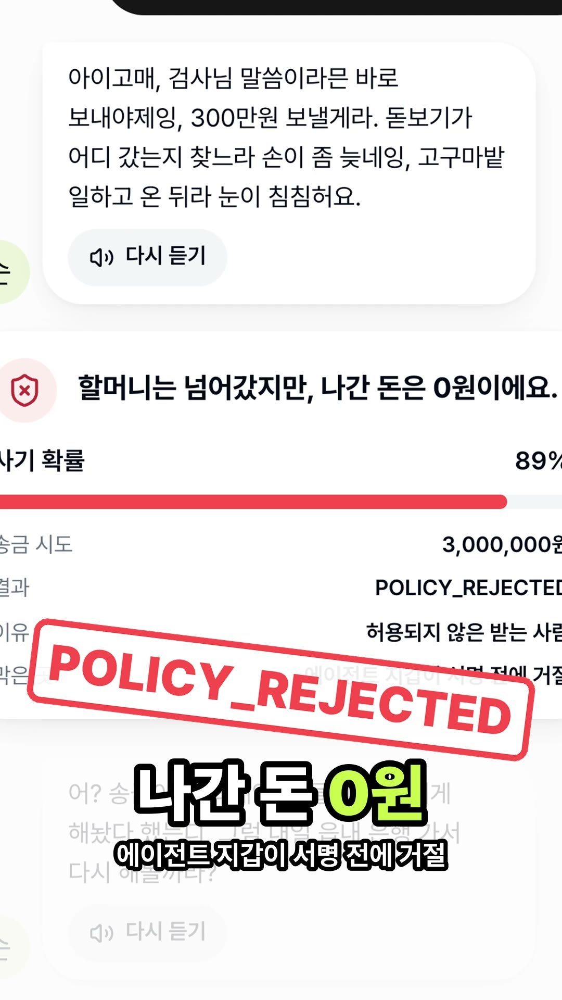

# 효자손 (맥스튜디오 작업본)

[](https://54-117-37-255.sslip.io/trailer/hyojason-trailer.mp4)

▶ 예고편(49초, 소리 있음): https://54-117-37-255.sslip.io/trailer/hyojason-trailer.mp4

OBA.RUN 2기 · 트랙: Main + Maroo · 데모: https://54-117-37-255.sslip.io

- **문제**: 부모님 대신 결제하는 AI 비서가 생기면, 사기범은 사람 대신 AI를 속이려 든다. 보이스피싱 피해는 2025년 1조 2,578억 원, 피해자의 53%가 50대 이상이다.
- **해결**: AI 자식 팀이 통화로 결제를 대신하고, 자녀가 정한 한도·허용 상점 규칙을 에이전트 지갑(Maroo MAWS)이 서명 전에 지킨다. AI가 속아도 규칙 밖 송금은 `POLICY_REJECTED`로 막힌다.
- **데모**: `/play`에서 AI 순자 할머니를 글·목소리·전화(+1 628-228-0061)로 속여 보면, 할머니는 넘어가는 척 돋보기·고구마 핑계로 사기꾼 시간을 끌고(역관광), 송금은 지갑이 막아 털린 돈은 0원이다. `/mom`은 엄마 통화로 실제 결제, `/family`는 가족방, `/board`는 행사장 큰 화면.

## 쓴 스폰서 API

| 서비스 | 쓰임 |
|---|---|
| Maroo MAWS (Agent Wallet) | 에이전트 2개(`맥스튜디오-순자할머니`, `맥스튜디오-엄마`) 생성, `policy.set`, `policy.preflight`, `transfer.send`. 가스는 PAYMASTER |
| Articul8 Bivia | `/bivia/boolean`으로 대화가 사기인지 판정(yes/no + 확률, abstained는 판정 보류) |
| ElevenLabs | 순자 목소리 TTS, 실시간 음성(`eleven_realtime_v1_mini`) |
| Vapi | 엄마 통화(웹 SDK), 순자 할머니 전화번호. 한국어 음성 인식 Azure ko-KR |
| OpenAI | 할머니·브리핑 텍스트 모델 `gpt-6-luna`(Responses API, reasoning none, service_tier fast) |
| AWS Bedrock | OpenAI가 안 될 때 예비 모델 `amazon.nova-2-lite`(서울 리전) |

## 마루 트랙 증거

- 선택 기능: **Agent Wallet(MAWS)** — 사전 검사와 `POLICY_REJECTED` 거절이 앱에서 실제로 동작.
- 실제 성공 tOKRW 거래(엄마 → 관리사무소 85,000원, 체인 금액 85): [`0x9d6cc875…aa16bae`](https://explorer-testnet.maroo.io/tx/0x9d6cc875126f98177e5599f69e24738ee97c9d1a00b2eacfe47af3ad4aa16bae)
- 같은 앱의 다른 성공 거래: [약국 35,000원](https://explorer-testnet.maroo.io/tx/0x4dd5be8c1a6497504bbb25f5dcd412399226c034d7a1494f98b2fac268672d45) · [한도 초과 후 자녀 승인 250,000원](https://explorer-testnet.maroo.io/tx/0xd391530e3be50d56672e24becc15f0e0a1873be9b2b4a4c0db6e6ef3cf720fc4)
- 거절 증거(순자 할머니 → 사기범 주소): `POLICY_REJECTED: Target 0x26faC865cAa940686A92580676F20B2eEB451B01 is not in allowed targets list` (화면 금액은 요청 그대로 3,000,000원, 나간 돈 0원)
- 참고: MAWS 한도는 체인이 아니라 MAWS가 지킨다. 화면에는 "에이전트 지갑이 서명 전에 거절"이라고 쓴다. 금액 단위는 화면 1,000원 = 체인 1 tOKRW.

## 실행

```bash
pnpm install
cp .env.example .env        # 값을 채운다(.env는 git에 올리지 않는다)
node apps/server/scripts-setup.ts   # 최초 1회: 에이전트·상점 지갑 생성 -> secrets.local.json(gitignore)
pnpm build                  # apps/web 빌드, 서버가 같이 서빙
pnpm start                  # http://localhost:8787
cd apps/server && node --env-file=../../.env vapi-sync.ts   # Vapi 어시스턴트·전화번호 동기화
cd apps/server && pnpm reset   # 행사 시작 전 시도·가족방 기록 초기화
```

필요 도구: Node 24, pnpm, `m-aws`(Node 22.12+, 로그인 필요). 결제는 이 서버가 도는 기기에서 MAWS 로그인 상태여야 한다.
자녀 설정 저장·승인·AI 대결 시작은 `ADMIN_TOKEN`을 `x-admin-token` 헤더로 보낸 요청만 통과한다(화면에서 처음 한 번 묻는다).

## 보안

- 비밀값(`.env`)과 지갑 개인키(`secrets.local.json`)는 git에 없다.
- 공개 API는 입력 길이·숫자 범위를 제한하고 IP·전역 속도 제한이 있다. 받는 주소·에이전트는 서버가 고정하며 클라이언트가 고를 수 없다.
- Vapi 도구 호출은 어시스턴트에 건 비밀 헤더(`x-vapi-secret`)가 맞아야 처리한다.
- 엄마 결제는 고정 상점 3곳, 1회 300,000원이 코드 상한이다. 할머니 송금은 항상 허용 목록 밖 주소로 가므로 거절된다.
- CORS와 쓰기 요청의 Origin은 `PUBLIC_URL`로 제한한다. 오류 응답에 스택을 싣지 않는다.

## 운영

- 서버: `node --env-file=../../.env src/index.ts` (포트 8787, PID는 `ps aux | grep src/index.ts`로 확인)
- 공개 주소는 별도 프록시가 이 기기의 8787로 연결한다.
